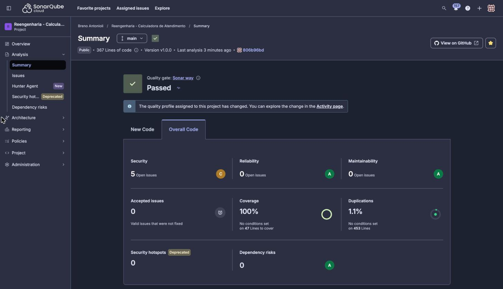
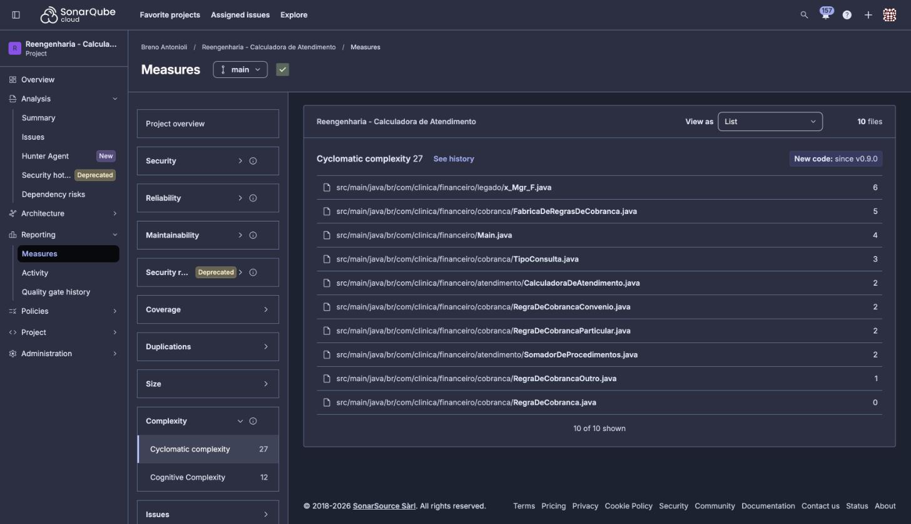
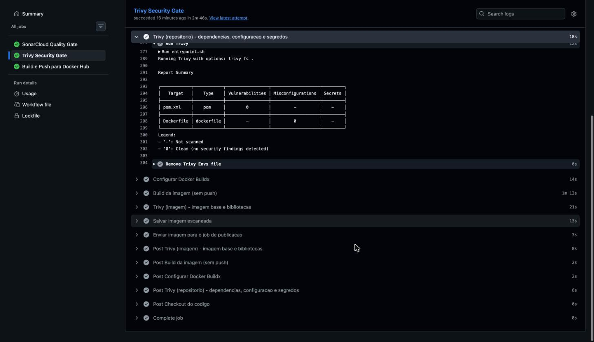
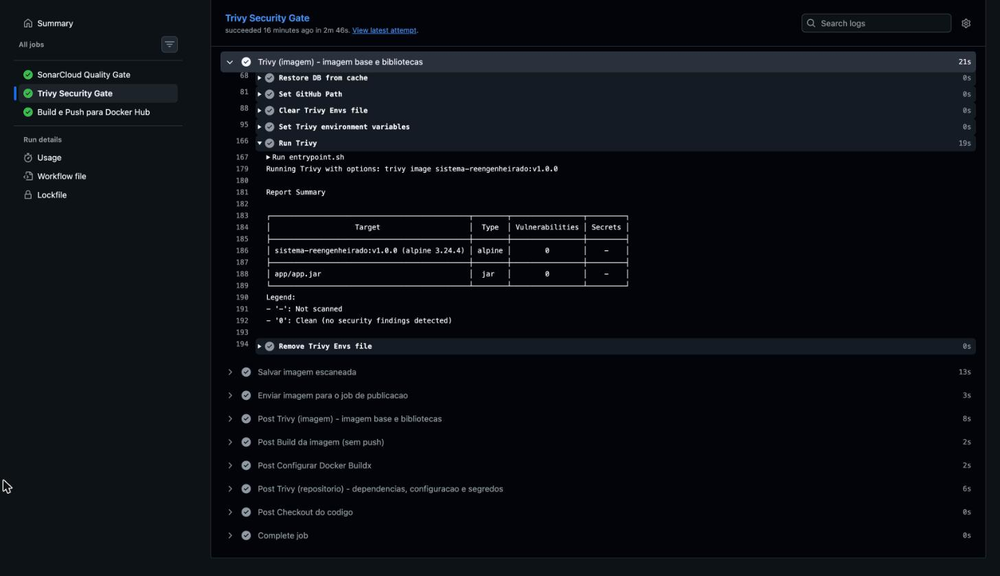
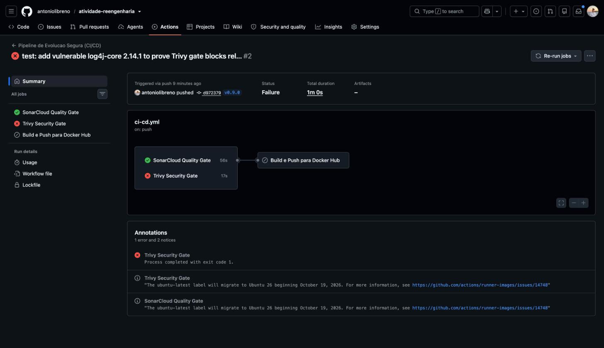
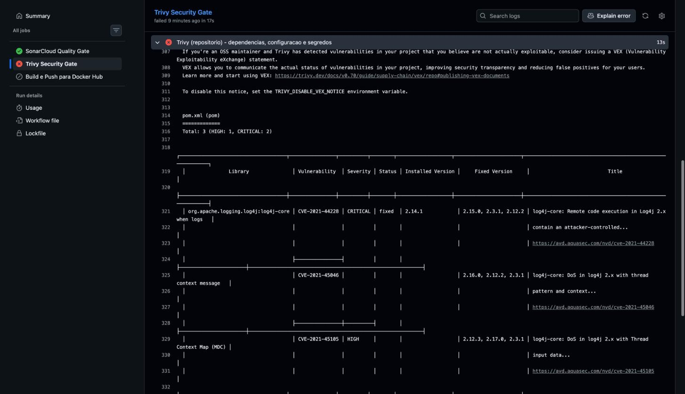

# Relatório: Pipeline de Evolução Segura (CI/CD)

Esteira de CI/CD do sistema reengenheirado: a cada tag de versão, o código passa por um portão de qualidade
(SonarCloud) e por um portão de segurança (Trivy), e só a imagem aprovada nos dois é publicada no Docker Hub.

## 1. Repositório GitHub

- Código-fonte: https://github.com/antoniolibreno/atividade-reengenharia
- Aba Actions: https://github.com/antoniolibreno/atividade-reengenharia/actions
- Workflow: `.github/workflows/ci-cd.yml`

## 2. Imagem no Docker Hub

- Repositório: https://hub.docker.com/r/antoniolibreno/sistema-reengenheirado
- Tag publicada automaticamente: `v1.0.0` (e `latest`), digest
  `sha256:8d707c435e8f2335443bfda3eff8bd346a02f04147bf9214322b5ddd118c4a18`
- Execução que publicou: https://github.com/antoniolibreno/atividade-reengenharia/actions/runs/42720274367
- Teste de quem for avaliar: `docker run --rm antoniolibreno/sistema-reengenheirado:v1.0.0` (mostra 6 linhas `[OK]`)

## 3. Como a esteira funciona

A esteira só é disparada pelo push de uma tag de versão (`v1.0.0`). Ela tem três jobs:

1. **qualidade**: compila, roda os 10 testes JUnit, gera cobertura com JaCoCo e envia tudo para o SonarCloud.
   O scanner espera o resultado do Quality Gate; se for reprovado, o job falha.
2. **seguranca**: roda o Trivy no repositório (dependências do `pom.xml`, Dockerfile e segredos), constrói a
   imagem multi-stage (JDK 21 para compilar, JRE 21 Alpine para rodar) e roda o Trivy de novo na imagem.
   Qualquer achado `CRITICAL` ou `HIGH` com correção disponível faz o job falhar.
3. **publicacao**: só executa se os dois jobs anteriores passarem. Publica no Docker Hub exatamente a imagem
   que o Trivy escaneou (o ID da imagem aparece no log dos dois jobs).

## 4. Evidência do Sonar

Painel: https://sonarcloud.io/summary/overall?id=antoniolibreno_atividade-reengenharia

*Figura 1. Análise da versão v1.0.0: Quality Gate "Sonar way" aprovado, 367 linhas de código, cobertura de 100%,
duplicação de 1,1% e nenhum Code Smell (Maintainability A) ou bug (Reliability A). Os 5 apontamentos de Security
são do próprio workflow, que referencia as GitHub Actions por tag de versão em vez de SHA de commit; não estão no
código Java e não reprovam o Quality Gate.*

*Figura 2. Measures > Complexity: complexidade ciclomática total de 27 (cognitiva de 12). A classe legada
`x_Mgr_F`, mantida de propósito como referência, é a mais complexa (6) concentrada em um único método; no código
reengenheirado a lógica fica distribuída em classes pequenas, cada regra de cobrança com complexidade de 1 a 2.
O período de New Code aparece como "since v0.9.0" porque a análise da tag de teste da seção 6 ficou registrada
no histórico.*

## 5. Evidência do Trivy

Execução: https://github.com/antoniolibreno/atividade-reengenharia/actions/runs/42720274367

*Figura 3. Trivy no repositório (`trivy fs`): nenhuma vulnerabilidade nas dependências do `pom.xml` e nenhuma
má configuração no `Dockerfile`.*

*Figura 4. Trivy na imagem `sistema-reengenheirado:v1.0.0`: nenhuma vulnerabilidade nos pacotes da Alpine 3.24.4
nem nas bibliotecas dentro do `app.jar`. Com os dois scans limpos, o job de publicação foi liberado.*

## 6. Prova de que a esteira bloqueia

Execução: https://github.com/antoniolibreno/atividade-reengenharia/actions/runs/42721792147

Em uma branch descartável foi adicionada ao `pom.xml` a dependência `log4j-core` 2.14.1 e enviada a tag de teste
`v0.9.0`. Resultado:

- **Trivy Security Gate: falhou** já no scan do repositório, com 3 vulnerabilidades (2 `CRITICAL`, 1 `HIGH`):
  CVE-2021-44228 (Log4Shell), CVE-2021-45046 e CVE-2021-45105.
- **SonarCloud Quality Gate: passou**, porque o código continuou igual; o problema estava só na dependência.
- **Build e Push para Docker Hub: skipped**. A tag `v0.9.0` não aparece no Docker Hub, que continua só com
  `v1.0.0` e `latest`.

Depois do teste, a tag `v0.9.0` e a branch foram apagadas; a execução continua no histórico do Actions.

*Figura 5. Execução da tag `v0.9.0`: SonarCloud aprovado, Trivy reprovado e "Build e Push para Docker Hub" pulado
(ícone cinza), porque depende dos dois portões.*

*Figura 6. Tabela do Trivy com as três CVEs do `log4j-core` 2.14.1, a versão instalada e as versões que corrigem
cada uma.*

## 7. Ensaio Crítico Final

O semestre começou com um diagnóstico. A classe `x_Mgr_F` reunia nomes sem significado, regras de cobrança
misturadas com log e um único método concentrando todas as decisões. Era a Entropia de Software em forma
concreta, aquilo que Lehman descreve nas leis da Mudança Contínua e da Complexidade Crescente: um sistema em
uso precisa mudar, e cada mudança aumenta sua complexidade, a menos que exista um trabalho ativo para
reduzi-la. Cada atalho que levou o código até aquele estado era Débito Técnico, uma dívida que cobra juros
sempre que alguém precisa entender ou alterar o programa. A reengenharia com SRP, Strategy e Factory, apoiada
pelos testes JUnit, pagou essa dívida uma vez. As próprias leis de Lehman, porém, mostram o limite dessa
solução: a refatoração é um evento pontual, enquanto a entropia é um processo contínuo. Sem um mecanismo que
acompanhe cada entrega, a próxima mudança feita às pressas voltaria a acumular juros.

A esteira de CI/CD é esse mecanismo. Ela transforma um cuidado que antes dependia da disciplina de cada pessoa
em regra automática, aplicada a toda versão, porque nenhuma tag chega ao Docker Hub sem passar por dois
portões. O SonarCloud torna o débito visível e mensurável: a cada versão calcula complexidade ciclomática,
code smells, duplicação e cobertura, e o Quality Gate, avaliado sobre o código novo, reprova a versão que piora
esses indicadores. A dívida antiga continua registrada (a `x_Mgr_F` foi mantida de propósito como referência),
mas deixa de poder crescer. O Trivy cuida de uma entropia que avança mesmo quando ninguém mexe no código: novas
CVEs são publicadas o tempo todo para as bibliotecas e para a imagem base, então uma versão segura hoje pode
não ser amanhã. Ao varrer dependências, Dockerfile e a própria imagem, e ao bloquear achados críticos ou altos
que já têm correção, a esteira impede que essa dívida de segurança seja embarcada. A esteira não elimina a
entropia, que é inerente a qualquer software em evolução, mas muda sua natureza: a degradação deixa de ser
silenciosa e gradual e passa a ser uma falha explícita, com causa identificada, que precisa ser resolvida antes
do lançamento. É o trabalho de redução de complexidade que Lehman descreve, feito de forma contínua, igual para
todos e sem exceção.
